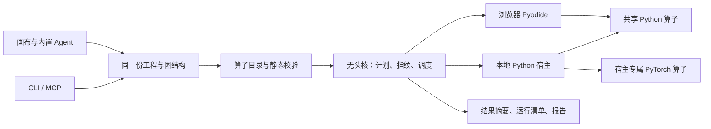

# 公开前代码与逻辑审查

日期：2026-10-02。范围：当前工作树，包括尚未提交的既有功能；本次没有自动提交、推送或改变仓库可见性。早期设计中的目标目录与路线图不等于现行实现，以接口登记、契约规格及本记录为当前说明。

## 结构与数据流

当前目录按职责划分，整体可以保留，无需为了统一名称进行大规模搬移。关键链路如下：

1. CSV 解析形成列式数据和数据身份；工程记录数据引用。原始数据不内嵌到 `.sciviz`。
2. 注册表声明算子、参数、执行等级和能力要求；端口解析处理函数签名等动态端口，校验器报告稳定错误码和未检查规则。
3. 求值计划与指纹决定重算范围。浏览器桥接层读写界面状态，无头核负责实际调度；CLI 也调用该核。
4. 浏览器与宿主使用同一份通用 Python 实现。GPU/训练能力由宿主适配器提供，避免浏览器不存在的库进入共享算子。
5. 输出留在执行面，通过摘要、探针和显式行值读取提供证据；运行清单记录数据、算子、环境与缺口。
6. 内置 Agent 使用工具规范、图补丁、基线和会话审计，结果回流到模型；外部 CLI/MCP 操作同一文件格式。模型凭据由宿主管理，不进入工具参数。

## 本次整理

| 问题 | 调整 | 目的 |
|---|---|---|
| 注册表运行时反向引用浏览器模块 store | 由浏览器注入自建模块提供者 | IR / 契约 / 无头核可直接在 Node 中使用 |
| `workflow/executor.ts` 实际只包装界面资产，名称与层级过时 | 移到 `store/runAssets.ts`，更新引用 | 明确职责，避免误以为存在第二个执行器 |
| 纯逻辑层缺少传递依赖检查 | 新增 `check:layers`，并纳入 `npm test` | 后续新增依赖也能发现越层，覆盖 36 个模块 |
| `catalog <type> --json` 忽略 type | 与文本模式统一筛选，未知类型明确失败 | 实现已有参数承诺，减少 Agent 工具负载 |
| 固定 CSV 默认路径指向开发者个人目录 | 改为显式配置，health 声明是否启用 | 新用户启动不依赖私人数据 |
| 凭据只能通过终端配置，只有两家 preset | 新增 BYOK 设置与多服务 preset | 每位用户配置自己的模型服务 |
| 凭据写入临时文件路径固定 | 使用受限权限的唯一暂存文件，串行合并写入 | 防止并发设置丢失和共享临时文件 |
| 错误仅匹配特定密钥前缀 | 用请求实际密钥脱敏，先脱敏再截断 | 覆盖 Gemini 等不同格式的凭据 |
| 多个对话面复用了控件 ID | 将只读侧栏与工作区控件 ID 分开 | 标签绑定和操作目标唯一 |
| 拼表资产沿图假定上游是数据源，函数或拆列后得到零行 | 改为使用实际引擎表摘要 | 资产规模与真实输出一致 |
| 报告浮窗遮挡普通模态通知 | 提升模态遮罩层级 | 打开和保存工程的提示可正常点击 |
| CI 使用 PowerShell 保留变量 `$Host` | 改为独立进程变量 | 宿主启动步骤可运行 |
| 个人临时工程放在 `public/` | 可恢复地移到忽略目录，补充忽略规则 | 避免构建时复制和对外提供私人实验 |

未改动共享 Python 算子或数值口径，没有引入新的生产依赖。既有工作树改动保留，未把它们自动纳入提交。

## BYOK 的边界

宿主 preset 是唯一的服务商清单，界面直接读取它。DeepSeek、OpenAI、Gemini、通义千问、Moonshot、OpenRouter 和自定义服务使用 Chat Completions 兼容协议；Go 保留专用适配器。不把兼容协议接入表述为所有模型、所有协议都已支持。

用户设置入口与模型工具分离，要求本机进程令牌、允许的 Origin 和 JSON。密钥只在短暂表单与宿主凭据文件出现，输入遮住，提交后清空，不回填、不存浏览器持久状态、不写工程或会话。配置接口只返回可用性和不含凭据的基础地址。空输入保留密钥，移除为显式操作；环境变量优先。

配置文件是明文，依靠本机文件权限与 Git 忽略保护，尚未实现系统凭据库。测试使用虚拟凭据和模拟上游，没有发送收费的模型请求。各服务的真实账户权限、额度和模型能力需要用户配置后确认。

## 仍需说明的实现边界

- 原 AGENTS 列出的 ENGINE_NODES 与模拟 executor 债务在当前工作树中已消除；剩余资产包装移出了纯逻辑层。过去的日志记录仍保留其历史语境。
- 契约层尚未完整实现轴语义、单位、数据划分泄漏、算子版本迁移；校验器明确返回 `notChecked`，运行清单也列出 `gaps`。不能宣称所有实验都已可复现。
- Python 用户代码在实际执行环境运行，本地宿主不是恶意代码沙箱。公开使用需要保持本机绑定，谨慎运行来源不明的工程。
- MCP 全目录可能超过响应预算，当前传输会截断文本；指定算子查询已修复，大负载分页仍需后续实现。MCP 冒烟不等于全部工具验收。
- 浏览器回归中存在旧 UI 名称、隐含固定数据集和重复控件定位等过期假设，本次按现行界面校正；最终通过与剩余失败见下方验证记录。
- 前端构建仍有大体积 chunk 提示。当前桌面脚本面向 Windows，其余系统尚未完成端到端验证。

## 公开内容与历史

已扫描当前源码和所有 Git refs 的历史对象，核对本机已知密钥，仅报告位置，不输出凭据。扫描时没有发现源码或既有 Git 对象与已知密钥匹配。旧测试中有一条来源不明的密钥样式字符串，当前已替换为明显的虚拟 fixture，历史版本仍保留原字符串。

Git 历史还包含已从工作树移除的科研数据压缩文件。公开当前快照和直接公开现有历史的范围不同；尚未执行历史改写或新建公开仓库，需在 README 审核后按用户选择处理。合成示例不依赖这份科研数据。

本次一次后端测试未隔离既有环境变量，失败输出意外包含了现有密钥。已隔离所有模型凭据环境变量并清除本地日志中的该值；对话中的工具输出无法撤回，已告知用户更换对应密钥。不会将该输出加入公开文件。

## 验证记录

验证日志位于忽略目录 `.tmp/public-prep-20261002/`。最终结果如下。

- 整理前：纯逻辑 481 项通过；构建通过；宿主 164 项中有一项旧 Go 测试错误，已改为验证生产专用适配器。
- BYOK 后端：32 项通过，覆盖受保护的 HTTP 配置、地址校验、密钥隔离、错误脱敏、配置删除、并发写入和模型缓存失效。
- BYOK 浏览器：真实 Chrome 通过保存、空输入保留、重开清空、移除；配置响应和浏览器存储无密钥。
- 合成工程：使用 CLI `new` 和原子 `patch` 创建；静态校验通过，离线计划通过，真实宿主执行 3 个节点完成，5 行数据符合 `y = 2x + 1`。
- 最终纯逻辑：483 / 483 通过，含拼表资产的真实规模与空表回归；层级、共享算子依赖与实现哈希检查通过。
- 宿主：171 / 171 通过，含真实 WebSocket 传输。
- 注册式数值真值：7 / 7 夹具，14 个独立数值比对，0 个不一致。
- CLI 盲测：27 / 27 步通过。
- MCP 冒烟：通过，含指定算子 JSON 查询与未知类型拒绝。
- 类型检查与生产构建：通过；保留前端大 chunk 提示。
- 完整 Chrome 回归：28 / 28 通过，0 跳过；包含 BYOK、配置与未配置的预载、真实 Pyodide Matplotlib、Agent 改图和取图、会话留存、项目报告和文件权限。

## 2026-10-03 发布处理

用户已确认公开。为避免把已删除的科研数据和旧测试凭据样式字符串随 Git 历史公开，发布从当前已验证版本创建独立的干净快照。原有完整本地历史保存在忽略目录的 Git bundle，既有远端继续作为私有历史备份；公开版本沿用 `ShangYangXU/sciviz-web` 地址。公开分支只跟踪新仓库的主分支，旧开发分支继续跟踪私有备份。

这次处理不改产品代码，不把测试结果表述为全部研究契约已实现，也不重新运行未发生变化的数值或交互测试。公开快照单独检查文件内容和可达历史；发布成功与实际可见性在上传后复核。

### 发布复核与 CI 修正

公开仓库已允许匿名读取，README、MIT 与引导手册齐全，旧历史留在私有备份，公开仓库无法读取旧提交。首次 CI 暴露未安装 torch 时的 verify 汇总误判；后续按既有 CLI-9 规定排除明确跳过项，保留真实失败判定，并补充两条 JSON/文本 CLI 进程回归。修正后本地纯逻辑 485/485、类型检查、构建、CLI 盲测 27/27 和数值夹具 7/7（14 个独立数值）通过。浏览器与宿主代码未改动，沿用前述交互与宿主验证结果；公网 CI 的最新状态见仓库 Actions。
